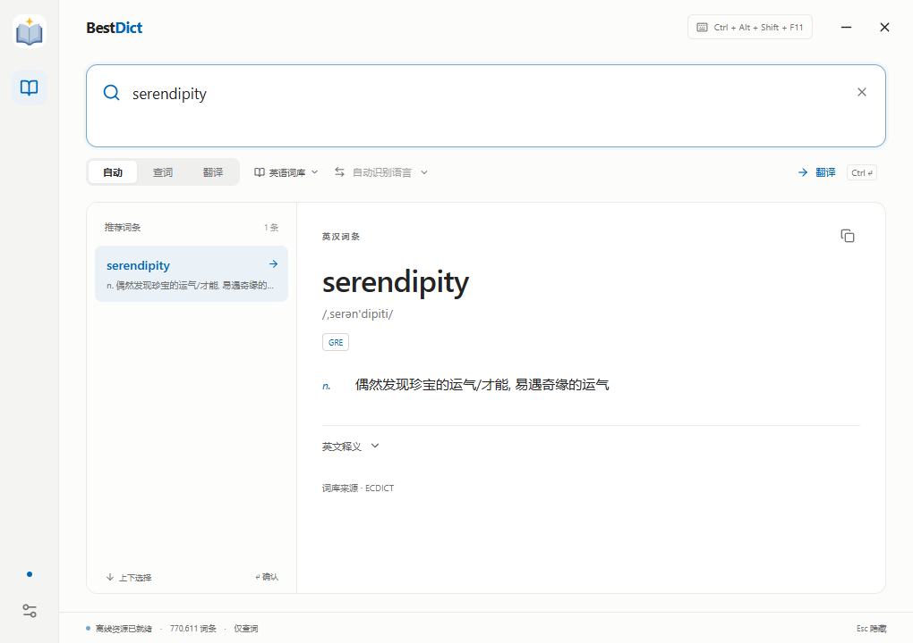
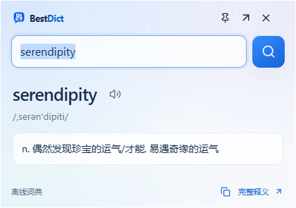

<div align="center">
  
  <h1>BestDict</h1>
  <p><strong>专注本地AI查词翻译<br/>纯净、无广告、无订阅</strong></p>
  <p>A quiet, offline-first desktop dictionary & translator.</p>
  <p>
    
    
    
    <a href="LICENSE"></a>
  </p>
  <p><a href="#features">功能</a> · <a href="#screenshots">界面</a> · <a href="#quick-start">开始使用</a> · <a href="#dictionaries">词库</a> · <a href="#development">开发</a> · <a href="#license">许可</a></p>
</div>

---

BestDict 是一款 Windows x64 / macOS 离线词典与翻译软件。按下 `Ctrl + Shift + D` 随时查词，关闭窗口后驻留托盘。无需账号、API Key 或订阅。

<a id="features"></a>
## 功能

- **离线查词**：内置约 77 万 ECDICT 英汉词条，支持联想、音标、词形变化与中文反查。
- **句子翻译**：Argos 提供基础中英翻译；Hy-MT2 提供本地 AI 多语言翻译。
- **风格与润色**：基本、专业、口语化、简短四种预设，可编辑提示词和新增风格；译文支持自定义润色与刷新。
- **扩展词库**：按需安装西班牙语、日语、韩语、法语的中文释义词库，支持自动匹配已安装词库。
- **桌面常驻**：全局快捷键、托盘、自启动、浅深色主题和中英文界面。
- **迷你模式**：`Alt + Shift + D` 唤起紧凑查词窗，支持发音、复制、固定置顶和展开完整释义；快捷键及失焦隐藏可在设置中调整。
- **截图翻译（Windows）**：在 **设置 → 截图翻译** 下载约 31 MB OCR 模型后，按 `Alt + Shift + S` 框选屏幕文字，松开后离线识别。结果窗支持编辑原文、翻译、复制、发音与置顶；优先使用已安装的 HY，或已启用的 Argos，未安装翻译模型仍可提取文字。`Esc` / 右键取消框选；截图仅在内存中处理，快捷键可在通用设置中修改。
- **毛玻璃界面**：冰蓝浅色与深海深色主题，Windows 11 22H2 及以上使用原生 Acrylic；其他系统保留应用内玻璃层次，并支持减少透明效果和动画。
- **发音缓存**：生成的音频在本机复用，重启后仍可使用；按文本、语言、音色、语速和模型区分，最多 128 MiB / 1,000 条，超限淘汰最近最少使用的音频，可在 **设置 → 发音 → 音频缓存** 查看占用并清理。

<a id="screenshots"></a>
## 界面预览

完整模式：查看完整释义、词形变化与英文解释。



迷你模式：`Alt + Shift + D` 随时查词，支持发音、固定置顶和展开完整释义。



<a id="quick-start"></a>
## 开始使用

1. 从 [Releases](https://github.com/hyieq/BestDict/releases/latest) 下载对应系统的安装包：Windows 使用 `Setup.exe`；Intel Mac 使用 `macOS-x64.dmg`；M 系列 Mac 使用 `macOS-arm64.dmg`，打开后将 BestDict 拖入「应用程序」。
2. 输入单词即可查词；`Ctrl + Shift + D` 唤起窗口，`Esc` 隐藏到托盘。
3. 需要整句翻译时，在 **设置 → 翻译引擎** 下载或导入模型。

安装包包含内置词库和必要运行时，无需另装 Python。翻译模型按需下载，启动时不会自动下载。

在设置页点击「检查更新」可查询 GitHub 正式发布版本，并下载对应系统的安装包。检查由手动触发，下载后自行运行安装包。

Mac 安装包尚未经过 Apple Developer ID 签名和公证，首次打开可能需要到「系统设置 → 隐私与安全性」允许打开。截图翻译目前仅支持 Windows；Mac 的系统权限、快捷键及实际发音体验仍需真机验收。

| 引擎 | 下载大小 | 用途 |
| --- | --- | --- |
| Argos Translate | 约 145 MB | 基础中英双向翻译，支持自动翻译句子与 `Ctrl + Enter` |
| Hy-MT2-1.8B Q4_K_M | 约 1.13 GB | AI 翻译、风格改写与润色，支持中文与英、西、日、韩、法互译 |

翻译按钮和 `Ctrl + Enter` 只翻译当前内容，修改后优先查词；清空输入会恢复自动模式。主动选择「句子翻译」时可连续编辑。

AI 通过输入框右侧按钮启动；已有译文时，切换风格会重新生成。输入润色要求后点击「润色并刷新」。如果模型返回相同内容，界面会提示。

下载较慢时，可在引擎设置中复制官方链接，下载后导入。Argos 需同时导入中英两个 `.argosmodel` 文件；MT2 使用官方 Q4_K_M GGUF。升级自 MT1.5 时需重新获取 MT2 模型，旧文件不会自动删除。推荐至少 8 GB 内存，推理速度取决于硬件。

<a id="dictionaries"></a>
## 词库与本地数据

扩展词库在 **设置 → 词库** 安装或导入，来源为 [Kaikki / Wiktextract](https://kaikki.org/dictionary/rawdata.html) 的中文维基词典数据。四种语言共享约 224 MB 的源数据缓存；实际词条数随上游更新而变化。支持中文 Wiktextract JSONL / gzip 导入。

原文和译文在本机处理，不上传或记录查询日志。设置与下载资源保存在 `%APPDATA%\BestDict\`；可选资源不进入安装包。模型可能误译，风格改写的效果也会随文本而变化。
发音音频保存在该目录下的 `speech-cache`，文件名不包含查询文本；清理缓存会删除生成的音频，保留已下载的语音模型。

<a id="development"></a>
## 🛠️ Development

### 环境

- Windows x64；Node.js **22+**、npm。
- [uv](https://docs.astral.sh/uv/) 与 Python 3.12。
- 获取开发依赖和初始资源时需要网络。
- 制作独立安装包时需 Visual Studio 的 x64 可再分发 CRT 目录，
  或用 `BESTDICT_VC_REDIST_DIR` 指定 `Microsoft.VC*.CRT` 目录。

### 开发启动

在仓库目录中运行：

```powershell
npm.cmd ci
uv python install 3.12
uv venv .venv --python 3.12
uv pip install --python .venv\Scripts\python.exe ctranslate2==4.6.0 sentencepiece==0.2.1 setuptools==80.9.0 pillow==12.3.0
.venv\Scripts\python.exe scripts\setup_assets.py
.venv\Scripts\python.exe scripts\setup_hy_runtime.py
.venv\Scripts\python.exe scripts\make_icons.py
.venv\Scripts\python.exe scripts\copy_licenses.py
.venv\Scripts\python.exe scripts\bundle_vc_runtime.py
npm.cmd run dev
```

`setup_assets.py` 准备内置词库与嵌入式 Python；
`setup_hy_runtime.py` 只获取 CPU 推理程序和许可。**两个脚本均不下载翻译模型权重**。
开发客户端也默认为「仅查词」，模型通过设置主动下载。
下载缓存位于项目 `.cache`，失败可重试。
`make_icons.py` 从 `resources/branding/app-icon-source.png` 编码 PNG 与多尺寸 Windows ICO，保留原始图案。

### 验证和打包

```powershell
npm.cmd run build
npm.cmd test
npm.cmd run test:desktop
npm.cmd run package
```

安装包位于 `release/`。桌面测试使用独立配置，
不修改真实用户的开机启动，也不关闭正在运行的客户端。
完成上面的环境准备后，也可以双击根目录的 `package.bat` 打包，默认输出到
`release/v<版本号>/`，结束后保留窗口显示结果。命令行运行 `./package.bat --no-pause`
可跳过结束暂停；已设置 `BESTDICT_RELEASE_DIR` 时沿用指定目录。
完整资源与打包后测试见 [测试文档](docs/TESTING.md)。
`npm test` 默认跳过真实模型推理；显式准备测试模型并设置 `BESTDICT_REAL_ASSETS=1` 后执行完整推理测试。
打包脚本还会扫描发行资源，发现 Argos / HY 权重时报告失败。

<details>
<summary>下载受代理或网络环境影响时</summary>

Node 无法下载 Electron 时，可通过 Python 准备相同的官方程序：

```powershell
npm.cmd ci --ignore-scripts
.venv\Scripts\python.exe scripts\fetch_electron.py
```

安装器工具下载超时，可预先准备固定版本并校验：

```powershell
.venv\Scripts\python.exe scripts\setup_build_tools.py
npm.cmd run package
```

备用下载仍使用官方来源，没有改用第三方镜像。

如果 Windows 占用了上次的打包目录，可指定独立输出目录再打包：

```powershell
$env:BESTDICT_RELEASE_DIR = "$PWD\release\v0.4.13"
npm.cmd run package
Remove-Item Env:BESTDICT_RELEASE_DIR
```

这种情况下安装包与 `win-unpacked` 都位于指定目录，测试时相应修改 `BESTDICT_TEST_EXE`。

</details>

## 译文发音

单词、基础译文和 AI 译文旁的喇叭按钮支持点击播放、再次点击停止，准备音频时也能停止。
切换查询、打开设置或隐藏窗口会停止当前发音。音色、语速和引擎在 **设置 → 发音** 中选择。
设置中的“试听中文 / 试听英文”使用当前未保存的音色和语速；修改参数或关闭设置会停止试听，试听不会保存设置。

默认自动模式先使用系统已安装音色；安装 Kokoro INT8 中英语音包后，中英文优先使用 Kokoro。
选用 Kokoro 时，显示主界面、迷你界面或截图结果会在后台预加载模型，连续发音复用已加载模型。
长句和段落会按自然短语分段，首段生成后开始播放，同时继续生成后续内容；推理较慢时自动增加缓冲。
停止或切换内容会清空待播音频，只有完整生成的音频才保存到缓存。
隐藏到托盘后空闲 2 分钟释放模型，快速唤醒继续复用；退出或切换到系统语音时立即释放。
语音包约 147 MB，独立按需下载，也可复制官方链接后导入 `.tar.bz2` 文件，导入时验证 SHA-256。
其他语言使用对应的系统音色；没有匹配音色时会提示安装，不会用错误语言朗读。
所有合成均在本机进行。Windows 使用 System.Speech，macOS 使用系统 `say`；Kokoro 共用模型、分别安装平台运行库。
macOS 的实际声音设备体验仍需真机验收。

开发环境运行 `.venv/Scripts/python.exe scripts/setup_tts_runtime.py` 准备语音运行库；正常资源初始化也会执行这一步。
`npm run test:speech` 验证桌面播放控制；`python -m unittest discover -s tests -p test_speech_installer.py` 验证语音包安装。
真实 Kokoro 测试使用 `.cache/speech-validation/kokoro/model` 中已安装的模型，设置 `BESTDICT_TEST_KOKORO=1` 后运行 `node --test tests/speech.test.cjs`。

## 贡献

欢迎提交 Issue 和 Pull Request。请附上复现步骤与平台信息，参见 [贡献指南](CONTRIBUTING.md) 和 [更新记录](CHANGELOG.md)。

<a id="license"></a>
## 📄 许可与致谢

**项目代码采用 [MIT License](LICENSE)。** 此许可不覆盖第三方词库、模型、Microsoft 运行库或其他依赖。

| 资源 | 来源 | 许可 |
| --- | --- | --- |
| ECDICT | [skywind3000/ECDICT](https://github.com/skywind3000/ECDICT) | MIT |
| 多语言词库 | [Wiktionary / Kaikki](https://kaikki.org/dictionary/) | Wiktionary CC-BY-SA / GFDL 数据许可 |
| Hy-MT2 | [Tencent Hunyuan](https://huggingface.co/tencent/Hy-MT2-1.8B) | Apache-2.0 |
| llama.cpp | [ggml-org/llama.cpp](https://github.com/ggml-org/llama.cpp) | MIT |
| Argos / OPUS-MT 模型 | [Argos Open Tech](https://github.com/argosopentech/argos-translate) | 所用原始 OPUS 模型为 CC BY 4.0 |
| Electron、React、Lucide、CTranslate2 等 | 各上游项目 | 见第三方说明 |

完整来源与随包许可见 [THIRD-PARTY-NOTICES](resources/THIRD-PARTY-NOTICES.txt)。
感谢词库作者、维基词典贡献者、Kaikki / Wiktextract、腾讯混元及推理工具维护者。
