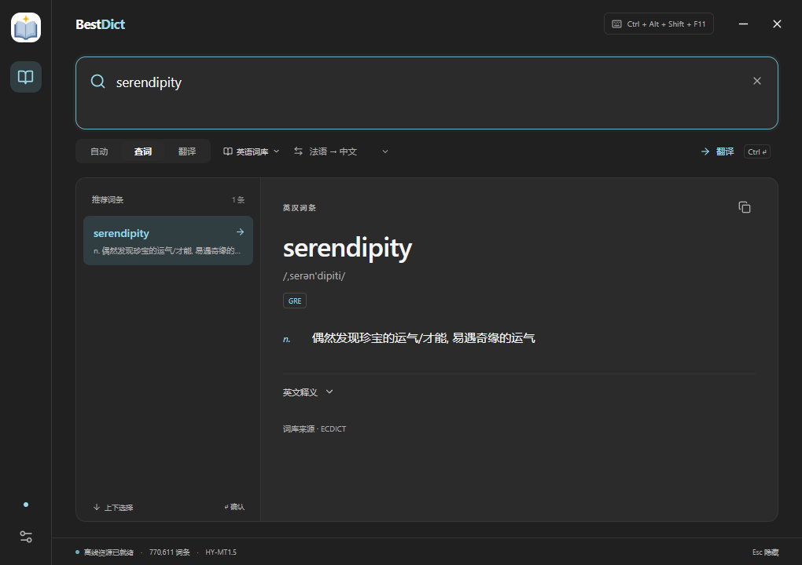
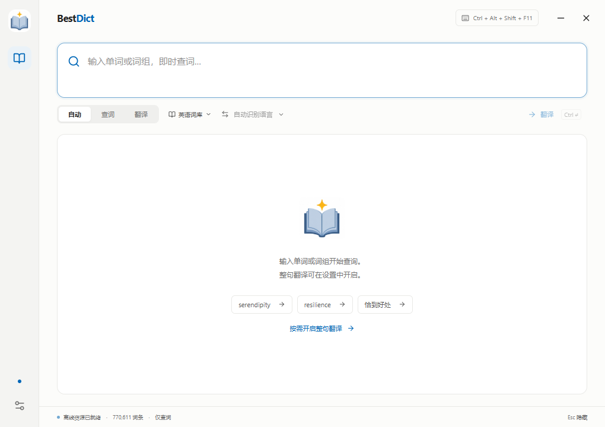
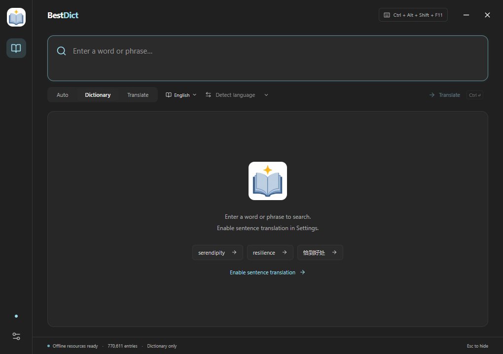
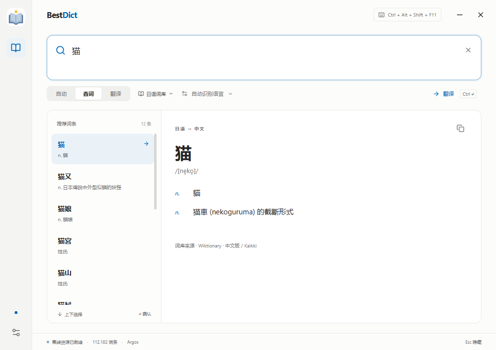
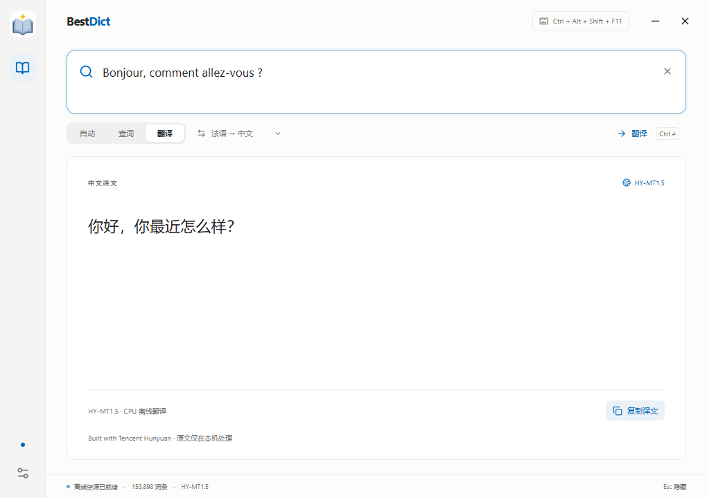
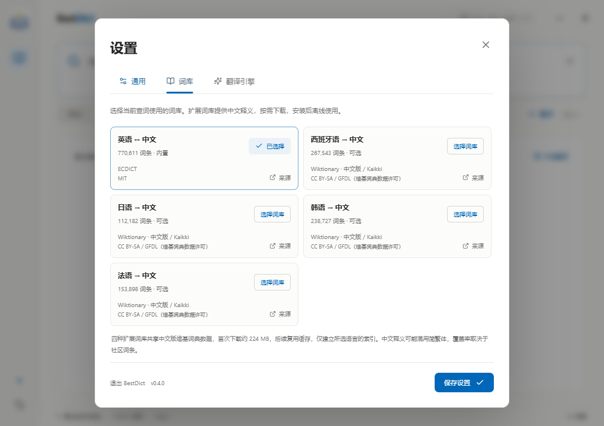
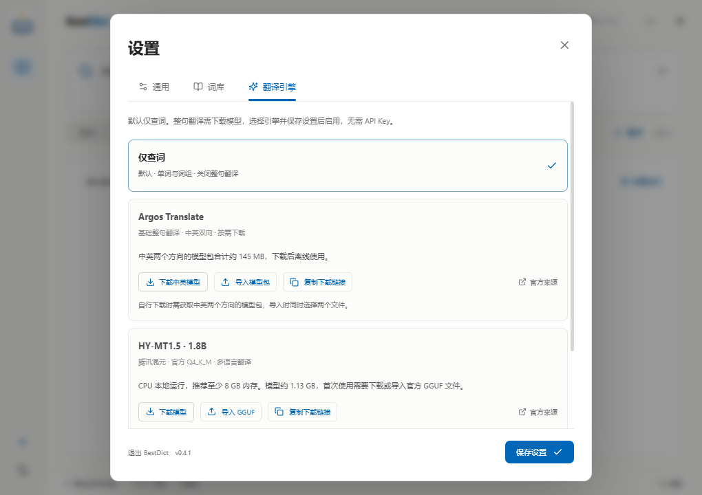
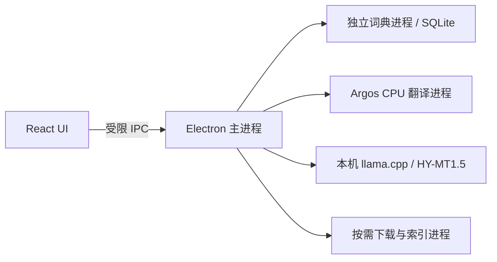
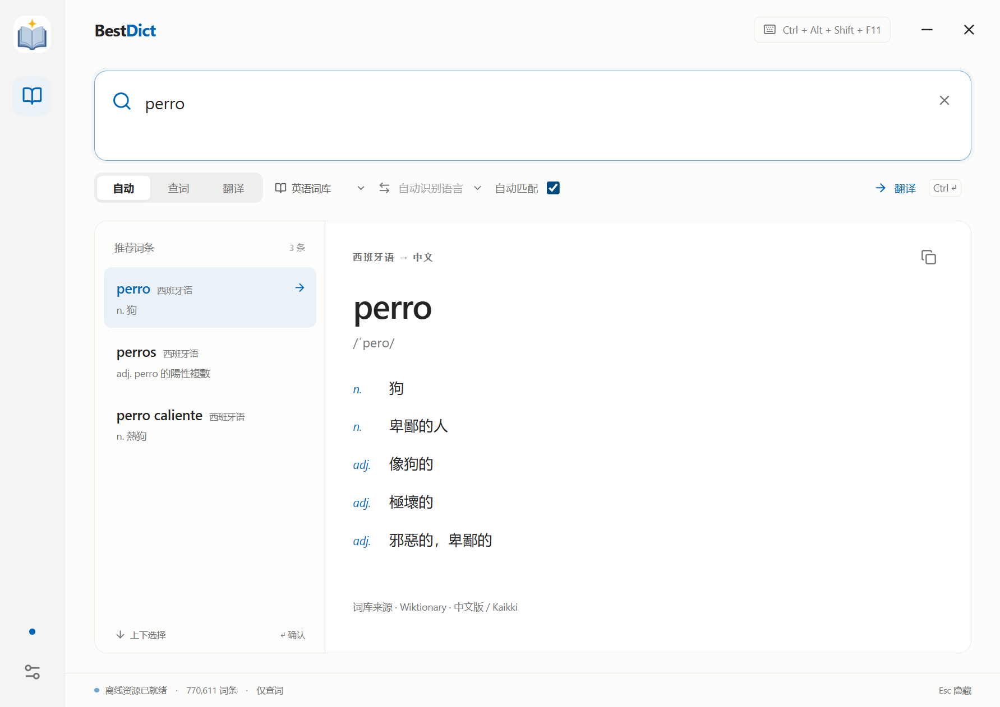
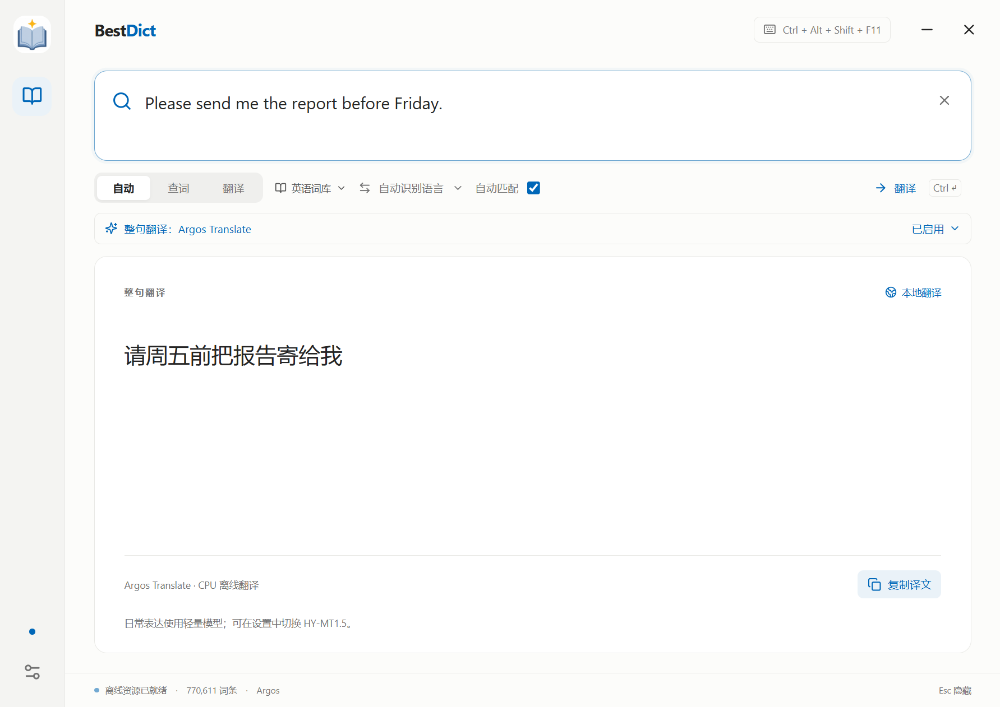

<div align="center">
  
  <h1>BestDict</h1>
  <p><strong>专注本地AI查词翻译<br/>纯净、无广告、无订阅</strong></p>
  <p>A quiet, offline-first desktop dictionary & translator.</p>
  <p>
    
    
    
    <a href="LICENSE"></a>
  </p>
  <p><a href="#features">功能</a> · <a href="#screenshots">界面</a> · <a href="#quick-start">开始使用</a> · <a href="#dictionaries">词库</a> · <a href="#development">开发</a> · <a href="#license">许可</a></p>
</div>

---

BestDict 围绕「输入 → 理解 → 回到工作」设计。按下快捷键查词或翻译整句，
关闭后安静地留在托盘。没有账户、广告或云同步，日常查词与翻译可以完全在本机完成。

**当前发行与验证平台：Windows x64。** UI 使用 Web 技术，桌面集成与推理服务独立，
为后续 macOS / Linux 适配保留边界；这些平台目前尚未打包验证。

<a id="features"></a>
## ✨ 功能

- **快捷键唤起** — 默认 `Ctrl + Shift + D` 显示 / 隐藏，每次唤起聚焦并选中输入。
- **即时查词** — 前缀联想、相近拼写、音标、中文释义和词形变化。
- **77 万英汉词条** — 内置 [ECDICT](https://github.com/skywind3000/ECDICT)，支持中文释义反查。
- **按需整句翻译** — Argos 中英模型与腾讯 **HY-MT1.5-1.8B**，均需手动下载、启用。
- **按需扩展词库** — 西班牙语、日语、韩语、法语的中文释义词库，手动下载 / 导入后离线使用。
- **克制的视觉** — `#fcfcfa` 浅色底、Windows 11 风格中性深灰主题，可跟随系统。
- **后台常驻** — 托盘、单实例、登录自启动与快捷键设置。
- **界面语言** — 默认简体中文，可切换 English，无需重启；词库释义保持原始语言。
- **本机处理** — 推理不阻塞查词；取消过时请求，模型空闲一分钟后释放。

<a id="screenshots"></a>
## 🖼️ 界面

以下为真实客户端截图，使用独立测试快捷键；默认仍为 `Ctrl + Shift + D`。

| 浅色 · 即时查词 | 深色 · Windows 11 风格 |
| --- | --- |
|  |  |

| 简洁主页 | English interface |
| --- | --- |
|  |  |

| 日语词库 · 中文释义 | HY-MT1.5 · 法译中 |
| --- | --- |
|  |  |

<details>
<summary>词库选择与翻译引擎设置</summary>



截图中的可选词库已经由测试用户安装；新客户端只内置英语词库。



首次安装时两套模型均未下载，默认选择「仅查词」。

</details>

<a id="quick-start"></a>
## 🚀 开始使用

### 安装

从仓库的 **Releases** 下载 `BestDict-<版本>-x64-Setup.exe`，运行安装程序。
安装包包含 ECDICT 和必要运行时，**默认只有单词、词组查询**。
两套翻译模型均不进入安装包，启动时不会自动下载。无需另外安装 Python 或申请 API Key。

本地构建后也可以运行 `release/win-unpacked/BestDict.exe`，但需要保留整个目录。
正式版首次运行默认启用登录自启动，登录时隐藏到托盘；可在设置中关闭。
在 **设置 → 通用 → 界面语言** 选择简体中文或 English，保存后立即生效。

### 操作

| 操作 | 行为 |
| --- | --- |
| `Ctrl + Shift + D` | 显示 / 隐藏；被遮挡时先唤回前台 |
| 输入单词或词组 | 自动检索候选词与释义 |
| `↑` / `↓` | 选择推荐词条 |
| `Enter` | 查词时确认词条；翻译模式下换行 |
| `Ctrl + Enter` | 已开启引擎时立即翻译；未开启时显示启用引导 |
| `Esc` / 关闭按钮 | 隐藏到托盘 |
| 最小化按钮 | 隐藏到托盘，保留托盘图标 |
| 单击 / 双击托盘图标 | 打开窗口并聚焦输入 |
| 右键托盘图标 → 设置 | 打开偏好设置 |
| 托盘菜单 → 退出 | 结束应用与本地服务 |

自动模式优先查单词和已收录词组；启用翻译引擎后，句子转入翻译。
未启用时输入句子会提示前往设置，查词仍正常可用。短中文、短日文或有歧义的内容，
可以切换「查词 / 翻译」。翻译约在停止输入 550ms 后触发，每次最多 5,000 字符。
输入法组合过程中不会发起请求。

首次最小化会提示托盘入口。Windows 如果把图标放在任务栏右下角的 `^` 中，
可在那里找到 BestDict；也可通过 **设置 → 通用 → 系统托盘 → 系统设置**
进入 Windows 任务栏设置，调整图标显示。应用运行期间保留托盘，退出时移除。

## 🧠 离线翻译引擎

| 引擎 | 获取方式 | 应用中开放的方向 | 适合 |
| --- | --- | --- | --- |
| 仅查词（默认） | 无需下载模型 | 单词、词组查询 | 日常查词 |
| Argos Translate | 设置中下载或导入，两个方向合计约 145 MB | 中英双向 | 低资源占用、日常短句 |
| HY-MT1.5-1.8B | 设置中下载或导入 | 中文与英、西、日、韩、法互译 | 更复杂表达、多语言场景 |

### 启用或关闭整句翻译

1. 打开 **设置 → 翻译引擎**。
2. Argos 点击「下载中英模型」；HY 阅读模型许可后点击「下载模型」，或导入官方 `HY-MT1.5-1.8B-Q4_K_M.gguf`。
3. 完成后选择对应引擎并**保存设置**，才会开启整句翻译。
4. 在主界面的语言方向中选择目标，或使用自动识别。

客户端下载较慢时，可使用引擎卡片上的 **复制下载链接**，粘贴到浏览器或下载工具：

- **Argos** 一次复制中英两个官方链接，每行一个。下载两个 `.argosmodel` 文件后，点击「导入模型包」，同时选择两个文件；无需重命名或解压。
- **HY-MT1.5** 复制固定版本的官方 Q4_K_M GGUF 直链。下载后点击「导入 GGUF」。

本地导入验证相同的文件大小与 SHA-256，导入过程中不会额外下载模型。完成后保存设置启用。

两个引擎互斥，随时可切换。选择「仅查词」并保存即可关闭翻译、停止推理服务；
已下载文件保留，之后重新启用无需再次下载。模型未安装或文件缺失时不能启用。
Argos 只有中英两个方向都通过固定 SHA-256 校验、完成解压后才标为可用；下载可取消或失败后重试。

HY 使用 [腾讯官方 GGUF](https://huggingface.co/tencent/HY-MT1.5-1.8B-GGUF) 的 **Q4_K_M** 版本，
文件约 **1.13 GB**。权重不进入默认安装包，也不会在启动时自动下载。
安装时验证固定版本的官方 SHA-256；导入目前也限定为该官方 Q4_K_M 文件。

推理由 [llama.cpp](https://github.com/ggml-org/llama.cpp) 的官方 Windows CPU 运行时执行，
不要求 CUDA。建议至少 8 GB 系统内存，速度和首次加载耗时取决于 CPU、内存与磁盘。
服务仅监听随机的本机回环端口，使用临时访问令牌，退出时关闭。

自动方向结合文字类型与当前词库判断，歧义输入请手动指定。模型可能误译，
机器译文不等同于权威词典释义。

**Built with Tencent Hunyuan.** 模型使用腾讯 HY 社区许可，包含地域等限制，
与项目代码的 MIT 许可不同。请阅读 [官方模型许可](https://huggingface.co/tencent/HY-MT1.5-1.8B-GGUF/blob/main/License.txt)。

<a id="dictionaries"></a>
## 📚 可选词库

打开 **设置 → 词库**，下载所需语言，选择词库并保存。
已安装的词库也可从主界面的词库入口切换。

新增词库来自 [Kaikki / Wiktextract 的中文版维基词典提取数据](https://kaikki.org/dictionary/rawdata.html)，
提供中文释义，原始内容可能混用简繁体。社区数据包含词形、专业词和罕见词，覆盖率与质量因语言而异。

| 词库 | 此次验证的索引词条数（含词形） | 默认安装 |
| --- | ---: | :---: |
| 英语 ↔ 中文 · ECDICT | 770,611 | ✅ |
| 西班牙语 → 中文 | 267,543 | — |
| 日语 → 中文 | 112,182 | — |
| 韩语 → 中文 | 238,727 | — |
| 法语 → 中文 | 153,898 | — |

四种扩展词库共享约 **224 MB** 的中文维基词典原始数据。
首次下载获取并缓存源文件，只建立所选语言的 SQLite 索引；
之后选择另一语言复用本机缓存。新用户不会自动下载这些词库。
上游持续更新，实际词条数以客户端导入后的统计为准。

也可以从来源页自行下载 `zh-extract.jsonl.gz` 后使用「导入」。
导入支持中文版 Wiktextract JSONL / gzip，暂不支持 MDX、StarDict 或其他语言版 Wiktionary 格式。

词库和翻译模型彼此独立：词库用于查词，HY 模型用于整句翻译。
ECDICT 中文反查属于释义反向检索；四种扩展词库目前尚未提供完整中文反查。

## 🔒 本地数据

- 原文与译文不会上传，不写入查询日志；翻译缓存只保存在进程内存中。
- 联网仅发生在主动下载资源、打开来源 / 许可网页，或开发时获取依赖。
- 设置与下载资源位于 Windows `%APPDATA%\BestDict\`。
- 可选资源保留来源、许可、版本或校验值；安装包不包含用户下载的文件。
- 源码仓库不包含大型模型、完整词库、开发缓存或个人配置。

<a id="development"></a>
## 🛠️ Development

### 环境

- Windows x64；Node.js **22+**、npm。
- [uv](https://docs.astral.sh/uv/) 与 Python 3.12。
- 获取开发依赖和初始资源时需要网络。
- 制作独立安装包时需 Visual Studio 的 x64 可再分发 CRT 目录，
  或用 `BESTDICT_VC_REDIST_DIR` 指定 `Microsoft.VC*.CRT` 目录。

### 开发启动

在仓库目录中运行：

```powershell
npm.cmd ci
uv python install 3.12
uv venv .venv --python 3.12
uv pip install --python .venv\Scripts\python.exe ctranslate2==4.6.0 sentencepiece==0.2.1 setuptools==80.9.0 pillow==12.3.0
.venv\Scripts\python.exe scripts\setup_assets.py
.venv\Scripts\python.exe scripts\setup_hy_runtime.py
.venv\Scripts\python.exe scripts\make_icons.py
.venv\Scripts\python.exe scripts\copy_licenses.py
.venv\Scripts\python.exe scripts\bundle_vc_runtime.py
npm.cmd run dev
```

`setup_assets.py` 准备内置词库与嵌入式 Python；
`setup_hy_runtime.py` 只获取 CPU 推理程序和许可。**两个脚本均不下载翻译模型权重**。
开发客户端也默认为「仅查词」，模型通过设置主动下载。
下载缓存位于项目 `.cache`，失败可重试。
`make_icons.py` 从 `resources/branding/app-icon-source.png` 编码 PNG 与多尺寸 Windows ICO，保留原始图案。

### 验证和打包

```powershell
npm.cmd run build
npm.cmd test
npm.cmd run test:desktop
npm.cmd run package
```

安装包位于 `release/`。桌面测试使用独立配置，
不修改真实用户的开机启动，也不关闭正在运行的客户端。
完整资源与打包后测试见 [测试文档](docs/TESTING.md)。
CI 仅构建前端并执行小型 fixture 测试，不自动下载大模型或完整词库。
`npm test` 默认跳过真实模型推理；显式准备测试模型并设置 `BESTDICT_REAL_ASSETS=1` 后执行完整推理测试。
打包脚本还会扫描发行资源，发现 Argos / HY 权重时报告失败。

### GitHub 自动发布

仓库的 [Release workflow](.github/workflows/release.yml) 在推送 `v*` 标签时，
自动准备 Windows x64 运行时与内置词库，执行测试、打包及打包后的桌面测试，
通过后创建 GitHub Release，上传安装包和 SHA-256 校验文件。
发布使用 GitHub Actions 自带的临时 `GITHUB_TOKEN`，无需配置个人访问令牌。

发布新版本时，先更新 `package.json`、`package-lock.json` 中的版本及 `CHANGELOG.md`，
提交并推送代码，再创建与版本一致的标签，例如：

```powershell
git tag -a v0.4.3 -m "BestDict v0.4.3"
git push origin v0.4.3
```

在 GitHub 的 **Actions → Release** 查看构建进度；完成后可在 **Releases** 下载。
若仓库禁用了 Actions，需先启用。失败时修复原因后可在 Actions 中重跑；
也可通过 **Run workflow** 选择已有版本标签。已发布版本不会被覆盖，应使用新版本标签。

<details>
<summary>下载受代理或网络环境影响时</summary>

Node 无法下载 Electron 时，可通过 Python 准备相同的官方程序：

```powershell
npm.cmd ci --ignore-scripts
.venv\Scripts\python.exe scripts\fetch_electron.py
```

安装器工具下载超时，可预先准备固定版本并校验：

```powershell
.venv\Scripts\python.exe scripts\setup_build_tools.py
npm.cmd run package
```

备用下载仍使用官方来源，没有改用第三方镜像。

如果 Windows 占用了上次的打包目录，可指定独立输出目录再打包：

```powershell
$env:BESTDICT_RELEASE_DIR = "$PWD\release\v0.4.3"
npm.cmd run package
Remove-Item Env:BESTDICT_RELEASE_DIR
```

这种情况下安装包与 `win-unpacked` 都位于指定目录，测试时相应修改 `BESTDICT_TEST_EXE`。

</details>

### 架构

```text
src/                      React UI、主题、输入法与键盘交互
src/i18n.ts               界面语言与参数格式化
electron/locales/en.json  UI 与原生菜单共享的英文文案
electron/main.cjs         窗口、托盘、快捷键、自启动与受限 IPC
electron/resources.cjs    资源进度、状态和路径管理
electron/hy.cjs           HY 推理、取消、缓存与空闲释放
electron/worker.cjs       子进程、JSON-lines 协议和超时
backend/worker.py         词典查询与 Argos CPU 推理
backend/resource_installer.py  下载、语言过滤、索引和模型校验
resources/                内置资源、可选资源目录与第三方许可
scripts/                  开发、资源准备、打包与桌面测试
tests/                    功能测试与异常资源验证
docs/                     实际截图与测试文档
```



渲染进程不直接访问文件系统或启动程序。查词、安装、模型推理分离，
请求序号防止旧结果覆盖新输入。

## 🗺️ Roadmap

- [x] Windows、托盘、自启动与全局快捷键
- [x] ECDICT、即时查词与中英整句翻译
- [x] 可选多语言词库与 HY-MT1.5 官方量化模型
- [x] 默认仅查词，Argos / HY 模型按需下载与启停
- [ ] macOS / Linux 运行时和平台验证
- [ ] 可配置在线翻译服务
- [ ] GPU 推理与更多量化版本
- [ ] 词库更新、更多来源及格式

## 🤝 贡献

欢迎提交 Issue 和 Pull Request。请阅读 [贡献指南](CONTRIBUTING.md)，
提供复现步骤、验证结果与平台信息。
变更记录见 [CHANGELOG](CHANGELOG.md)。

<a id="license"></a>
## 📄 许可与致谢

**项目代码采用 [MIT License](LICENSE)。** 此许可不覆盖第三方词库、模型、Microsoft 运行库或其他依赖。

| 资源 | 来源 | 许可 |
| --- | --- | --- |
| ECDICT | [skywind3000/ECDICT](https://github.com/skywind3000/ECDICT) | MIT |
| 多语言词库 | [Wiktionary / Kaikki](https://kaikki.org/dictionary/) | Wiktionary CC-BY-SA / GFDL 数据许可 |
| HY-MT1.5 | [Tencent Hunyuan](https://huggingface.co/tencent/HY-MT1.5-1.8B) | 腾讯 HY 社区许可（含地域限制） |
| llama.cpp | [ggml-org/llama.cpp](https://github.com/ggml-org/llama.cpp) | MIT |
| Argos / OPUS-MT 模型 | [Argos Open Tech](https://github.com/argosopentech/argos-translate) | 所用原始 OPUS 模型为 CC BY 4.0 |
| Electron、React、Lucide、CTranslate2 等 | 各上游项目 | 见第三方说明 |

完整来源与随包许可见 [THIRD-PARTY-NOTICES](resources/THIRD-PARTY-NOTICES.txt)。
感谢词库作者、维基词典贡献者、Kaikki / Wiktextract、腾讯混元及推理工具维护者。

### 自动匹配词库

主界面的词库下拉框可直接选择已安装词库。勾选右侧「自动匹配」后，会在已安装词库中优先查找完整词条：例如已安装西语词库时，输入 `perro` 即可看到「狗」，无需先切换词库。候选词旁显示语言；同形词优先当前词库，同时保留其他语言的完整匹配。自动匹配不会覆盖手动选择，取消勾选后只查所选词库。词库未收录的词仍可能无法识别；此功能不需要翻译模型或联网。



### 确认整句翻译已启用

Argos 手动导入时需同时选择中英两个方向的模型包。导入成功后显示「待保存启用」，点击「保存设置」，主界面会显示「整句翻译：Argos Translate · 已启用」。已安装但未启用时，可在引擎设置点击「启用此模型」再保存。导入校验失败时会显示错误，不会启用不完整模型。


